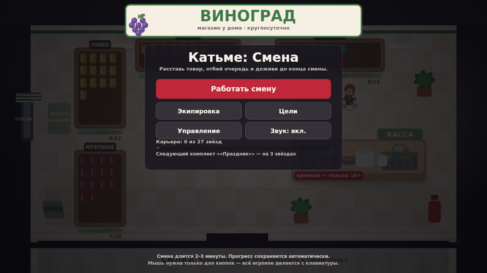
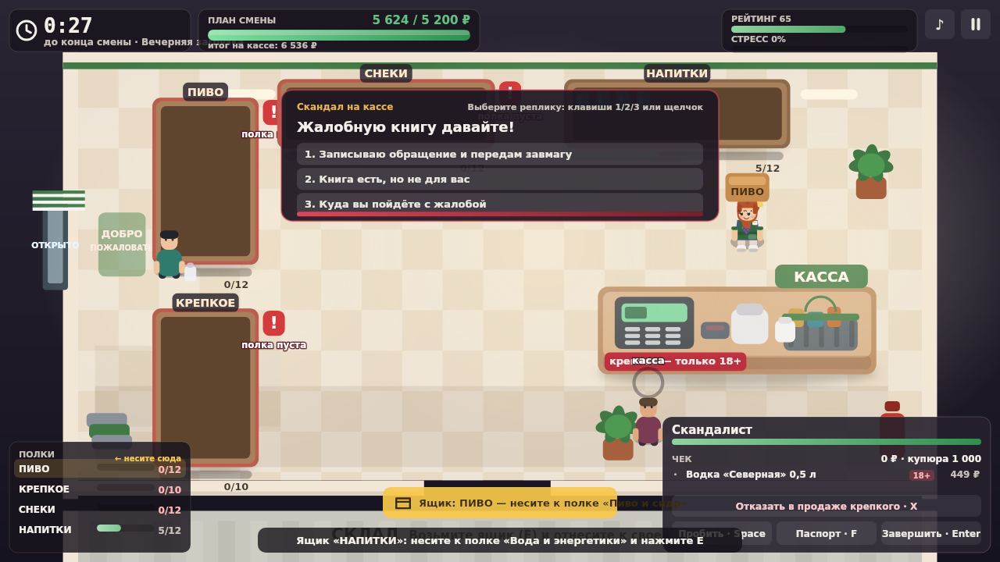
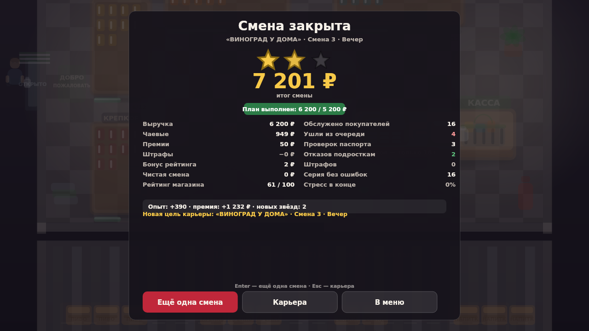

# Катьме: Смена

Браузерная аркада о смене продавщицы в магазине «ВИНОГРАД»: полки, касса, паспорта и очереди.
Катьме — девушка с рыжим хвостом и фирменным фартуком: это видно и в игре, и на иконке.
Одна смена длится 150–180 секунд, между сменами открываются новые адреса, форма и улучшения.

Версия сборки: **1.0.0** · HTML5 (Canvas 2D), без сборщика и без внешних библиотек ·
однопользовательская игра · управление с клавиатуры и мыши · русский язык интерфейса.



## Что это за игра

Катьме вышла на смену. За прилавком её ждут две несовместимые вещи: **полки, которые
опустевают**, и **покупатели, которые приходят по звонку**.

- **Зал.** Катьме бегает между складом и полками: берёт ящик (`E`), несёт к своей полке,
  выкладывает (`E`). Пустая полка — это ушедший без покупки покупатель, минус рейтинг и
  минус выручка.
- **Касса.** Покупатель подходит к кассе, встаёт в очередь (до трёх человек). Нужно пробить
  товар (`Space`), при «крепком» в чеке — проверить паспорт (`F`), отдать сдачу и закрыть
  чек (`Enter`). Продажа крепкого младше 18 — штраф 1 800 ₽ и минус рейтинг.
- **Стресс.** Каждая секунда ожидания в очереди и каждая пустая полка добавляют стресс.
  100 % стресса держится 4 секунды — если не разгрести очередь за это время, смену закрывают.
- **Диалоги.** «Залётный скандалист» требует жалобную книгу и ждёт выбора реплики
  (`1`/`2`/`3` или клик). Верный ответ — плюс к рейтингу, неверный — минус.



## Управление

Клавиши берутся по **физическому положению** (`KeyboardEvent.code`, а не `key`), поэтому
раскладка и регистр не важны: игра одинаково работает на русской и английской раскладке,
и модификаторы `Ё`/`\``–`Delete` не мешают. Мышь работает для кнопок и диалогов.

| Клавиша | Действие |
| --- | --- |
| `KeyW` `KeyA` `KeyS` `KeyD` / `ArrowUp` `ArrowLeft` `ArrowDown` `ArrowRight` | движение Катьме по залу и складу |
| `KeyE` | взять ящик, выложить ящик, встать за кассу |
| `Space` | пробить товар по штрихкоду |
| `KeyF` | проверить паспорт |
| `KeyX` | убрать «крепкое» из чека |
| `Escape` | пауза, выход из диалога |
| `KeyR` | перезапустить смену |
| `Digit1` `Digit2` `Digit3` | ответ в диалоге со скандалистом |
| `KeyM` | выключить и включить звук |
| `Enter` | завершить чек, подтвердить в меню |
| `ShiftLeft` / `ShiftRight` | рывок «второе дыхание» на короткое время |

## Смены, адреса и план

Девять смен в трёх магазинах. У каждого адреса своя планировка (4 или 5 полок), поток
покупателей, цены и цветовая гамма. План по выручке совпадает с порогом первой звезды:
«план выполнен» и «1★» — это одно и то же событие.

| Адрес | Смены | Длительность | План / 1★ | 2★ | 3★ |
| --- | --- | --- | --- | --- | --- |
| «ВИНОГРАД У ДОМА» | 3 | 150–180 с | 3 400 ₽ | 4 400 ₽ | 5 300 ₽ |
| «ВИНОГРАД НА МОСТОВОЙ» | 3 | 165–180 с | 3 700 ₽ | 4 800 ₽ | 5 700 ₽ |
| «ВИНОГРАД 24/7 НА ТРАССЕ» | 3 | 165–180 с | 3 900 ₽ | 5 100 ₽ | 6 000 ₽ |

Звёзды выставляются по порогам конкретной смены (у вечерних смен пороги выше — выше и поток).
Прогресс, звёзды, XP, кошелёк и цели сохраняются между запусками.

## Прогрессия

- **18 целей карьеры** — от «первой смены без штрафов» до «девяти смен без единого ушедшего».
- **6 комплектов формы** («Смена», «Праздник», «Котик», «Ночная смена», «Завмаг», «Легенда сети») —
  открываются за звёзды, влияют на вид Катьме.
- **5 улучшений** — кроссовки, сканер 2.0, радио на складе, перчатки, термос.
- **6 званий** от стажёра до легенды сети, начисляются за XP.



## Запуск локально

Игре нужен HTTP-сервер: модули ES и шрифты по `file://` браузер не отдаёт.

```bash
cd The-Alhocol-Famely
python3 -m http.server 8000 --bind 0.0.0.0
# открыть http://localhost:8000/
```

Страница `index.html` — диагностическая: игра стартует без SDK, а в `window.__KATME__`
пишутся версия, готовность и последняя ошибка. Для тестов и скриншотов этого достаточно.

Проверка синтаксиса и правил игры:

```bash
npm test          # 73 теста: модель смены, карьера, бот, платформа, клики, бренд, сборка
npm run sim       # прогон девяти смен ботом normal, таблица выручки и звёзд
npm run shots     # 12 скриншотов в docs/screenshots/
npm run promo     # обложка 800×470, иконки 512/256, тексты карточки
npm run pack      # три архива в dist/ + самопроверка содержимого
npm run verify    # распаковать архив и проиграть смену из него (18 проверок
                  #   «швы»: игра стартует, смена доигрывается, прогресс сохраняется)
npm run check     # всё вместе: тесты → сборка → проверка архива
```

## Сборки

`npm run pack` (он же `python3 tools/package.py`) собирает три архива и **сам проверяет**
их содержимое: наличие `index.html` в корне, наличие `/sdk.js`, ключевых модулей, шрифтов
и их лицензии, отсутствие тестов, инструментов и лишних каталогов.

Сверх этого `npm run verify` закрывает главный «шов» упаковки: он распаковывает
`dist/Katme_Yandex.zip` во временный каталог, поднимает заглушку браузера и запускает
**игру из архива** — стартует без SDK, проигрывает полную смену ботом, проверяет итоги,
звёзды, запись прогресса в `localStorage` и содержимое `window.__KATME__`. Именно эта
проверка ловит ошибку вида «в репозитории работает, в архиве нет».

| Архив | Что внутри | Размер |
| --- | --- | --- |
| `dist/Katme_Yandex.zip` | готовая сборка для Яндекс Игр: `index.html`, `src/`, `web/`, `assets/` (шрифты + лицензия) | ~800 КБ, 19 файлов (разворачивается ~1,6 МБ) |
| `dist/Katme_Source.zip` | исходники проекта: код, тесты, инструменты, документация, Godot-версия | ~3,3 МБ |
| `dist/Katme_Promo.zip` | обложка, иконки, тексты карточки и 12 скриншотов | ~2,6 МБ |

Архив для платформы распаковывается в корень: `index.html` лежит в корне архива, а не в
подкаталоге — именно так его ждёт загрузчик Яндекс Игр.

Пошаговая инструкция по публикации — в [`docs/YANDEX_UPLOAD.md`](docs/YANDEX_UPLOAD.md).
Отчёт о тестировании и его границах — в [`docs/QA_REPORT.md`](docs/QA_REPORT.md).

## Интеграция с платформой

Вся связь с Яндекс Играми изолирована в `web/platform.js` (~180 строк). Правила простые:

- игра **полностью работает без SDK** — если `YaGames` не найден, `Platform` молча переходит
  в локальный режим, и это же поведение используется в тестах;
- ни один вызов платформы не может уронить игру: всё в `try/catch`, ошибки пишутся в консоль;
- `LoadingAPI.ready()` вызывается после инициализации; `gameplayStart()`/`gameplayStop()`
  — на старте и на паузе/итогах смены;
- межстраничная реклама — только по нажатию «Ещё одна смена» на экране итогов и не чаще
  одного раза в 90 секунд; после показа игра автоматически ставится на паузу;
- сохранение всегда сначала локальное (`localStorage`, ключ `katme.profile.v1`), затем —
  в облако игрока (поле `katme`), с дебаунсом; при отсутствии игрока остаётся локальная версия.

## Структура проекта

```
index.html            диагностическая страница (запускается без SDK)
web/shell.html        страница, которая устанавливается как index.html в архив для платформы
web/platform.js       единственное место общения с SDK Яндекс Игр
src/game.js           Game: жизненный цикл, кадр, ввод, связка экранов
src/core/config.js    весь баланс: полки, товары, покупатели, стресс, смены, обновления
src/core/run.js       ShiftRun — детерминированная модель смены (без отрисовки)
src/core/career.js    профиль, звёзды, XP, цели, кошелёк, облачное хранилище
src/core/input.js     ввод по физическим клавишам
src/audio/audio.js    синтез звука (WebAudio), без файлов
src/render/*.js       отрисовка зала, эффекты, примитивы
src/ui/*.js           HUD смены и все экраны меню
src/ai/bot.js         бот-игрок: используется тестами и замером баланса
tools/simulate.js     таблица прогонов по всем сменам
tools/shoot.js        скриншоты через @napi-rs/canvas (без браузера)
tools/make_promo.js   обложка, иконки, тексты карточки
tools/package.py      сборка архивов + самопроверка
tools/verify_archive.js  запуск игры из собранного архива (проверка «шва» упаковки)
godot/                параллельная версия на Godot 4.3 (см. ниже)
tests/                61 тест на node:test
```

## Версия на Godot

В `godot/` лежит отдельный проект Godot 4.3 (`gl_compatibility`), который повторяет
модель смены: те же полки, товары, покупатели, стресс и итоги, но отрисовка через
`draw_*`-примитивы. Управление и баланс перенесены из `src/core/config.js`.

Это **сопутствующая версия, а не вторая готовая сборка**: интерфейс проще, часть эффектов
и анимаций отсутствует, звук не перенесён, сохранение прогресса не подключено. Архив
`Katme_Godot4.zip` в этом релизе не собирается. Экспорт проверяется только в редакторе.

## Что проверено, а что нет

Проверено: 73 автоматических теста (`npm test`), прогон всех девяти смен ботом
(`npm run sim`), ручная игра в браузере на десктопной раскладке, автоматическая проверка
собранного архива (`npm run verify`: старт без SDK, полная смена, сохранение прогресса),
синтаксис GDScript через сборку проекта в редакторе.

**Не проверено:**

- сборка **никогда не загружалась** в консоль разработчика Яндекс Игр и не проходила
  модерацию — это заготовка, а не опубликованная игра;
- облачные сохранения, реклама и события платформы **не проверялись на живом SDK**: в
  песочнице нет `YaGames`, поэтому `web/platform.js` тестируется только на заглушках;
- мобильные устройства, тач-управление и портретная ориентация: игра рассчитана на
  клавиатуру и горизонтальный экран, тач-интерфейс не делался;
- реальная производительность на слабых устройствах не измерялась (замеры только на
  машине сборки);
- звук проверялся на слух, микшер и предпочтения громкости не выносятся в настройки.

## Тематика, бренды и возрастной рейтинг

Игра — про продажу алкоголя, значит об этом нужно сказать прямо.

- «**ВИНОГРАД**» — **вымышленная сеть**: название, адреса, оформление и персонажи
  придуманы для игры. Реальные торговые сети и люди не упоминаются и не изображаются.
- Товары названы тоже вымышленно («Пиво «Солодовое»», «Водка «Северная»»), реальных
  марок и этикеток нет.
- Механика проверки паспорта показывает правильное поведение: продажа крепкого младше
  18 запрещена, отказ поощряется премией и рейтингом, продажа наказывается штрафом.
  Алкоголь не рекламируется, употребление не изображается.
- В карточке игры заявлен рейтинг **18+**. Будьте готовы к тому, что тематика может
  вызвать вопросы модерации: если платформа попросит смягчить контент, самое простое —
  заменить «крепкое» на «энергетики» и убрать упоминания алкоголя (правки в
  `src/core/config.js`, товары и подписи полок).

## Изображения, звук и права

- **Вся графика рисуется кодом**: зал, персонажи, бутылки, иконки — это примитивы Canvas 2D
  и Godot `draw_*`. Растровых художественных ассетов в проекте нет. Катьме рисуется
  по частям (хвост на резинке, чёлка, ресницы, румянец, платье, фартук со знаком сети) —
  цвета спрайта проверяются тестом, чтобы героиня не «потеряла» хвост при правках.
- **Обложка и иконки** собраны скриптом `tools/make_promo.js` из настоящего скриншота игры.
  Изображений, сгенерированных ИИ, в проекте **нет**.
- **Звук синтезируется кодом** (`src/audio/audio.js`, WebAudio): звонок, касса, шаги, штраф.
  Аудиофайлов нет.
- **Шрифты** — DejaVu Sans и DejaVu Sans Bold (лицензия Bitstream Vera + общественное
  достояние на правки DejaVu). Текст лицензии — `assets/fonts/LICENSE.txt`, он же едет
  внутрь архива для платформы. Шрифты подключаются через `@font-face` и ожидаются
  перед первым кадром (`Game.waitForFonts`), поэтому кириллица на канвасе выглядит
  одинаково на Linux, Windows и macOS, а не «как решит система».
- Каких-либо исключительных прав на вымышленную сеть «ВИНОГРАД» автор не заявляет и
  претендовать на них не собирается; совпадения с реальными магазинами случайны.

Лицензия на код, графику, звук и документы — в [`LICENSE.txt`](LICENSE.txt): свободное
использование и изменение при сохранении уведомления об авторских правах, без гарантий.

## Как замерялся баланс

Сложность выставлена не на глаз. Бот-игрок (`src/ai/bot.js`, три характера — `strong`,
`normal`, `weak`) прогоняет каждую смену на множестве семян, а `npm run sim` печатает
таблицу. Актуальный замер (20 семян на смену, бот `strong`):

| Смена | Средний итог | 1★ | 2★ | 3★ |
| --- | --- | --- | --- | --- |
| Дом · Утро | 5 068 ₽ | 20/20 | 14/20 | 8/20 |
| Дом · День | 6 459 ₽ | 20/20 | 17/20 | 12/20 |
| Дом · Вечер | 7 916 ₽ | 20/20 | 18/20 | 10/20 |
| Мостовая · Открытие | 5 545 ₽ | 20/20 | 16/20 | 8/20 |
| Мостовая · Час пик | 6 574 ₽ | 20/20 | 18/20 | 9/20 |
| Мостовая · Пятница | 7 981 ₽ | 20/20 | 17/20 | 12/20 |
| Трасса · Ночь | 6 004 ₽ | 20/20 | 18/20 | 10/20 |
| Трасса · Перед рассветом | 6 920 ₽ | 20/20 | 19/20 | 15/20 |
| Трасса · Закрытие | 8 283 ₽ | 20/20 | 16/20 | 14/20 |

Слабый бот берёт 1★ в 77 % прогонов, а 3★ — в 22 %: смена проходится даже при неуверенной
игре, а три звезды требуют почти безошибочной. Доводка баланса описана в комментариях
`src/core/config.js` — там же зафиксированы замеры, по которым выбраны пороги.
